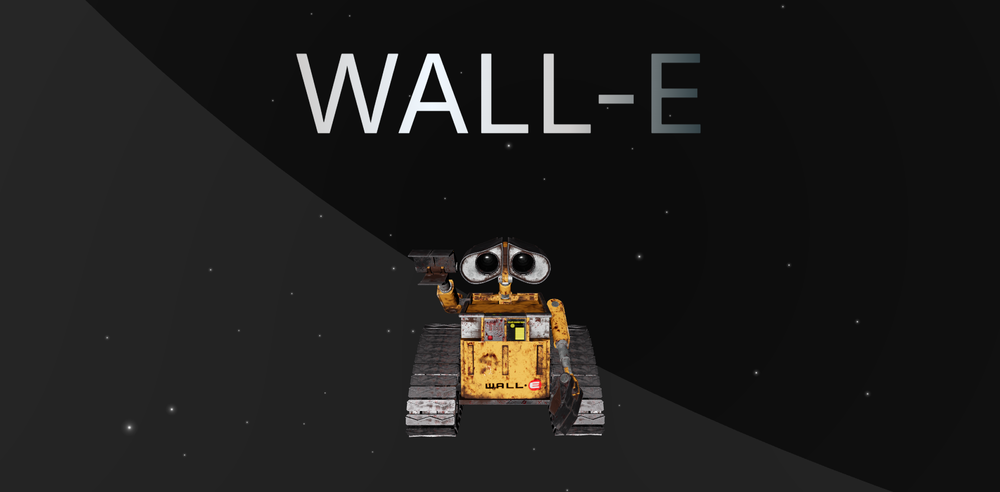

# WALL-E

A scroll-driven 3D experience built with Next.js, React Three Fiber, and GSAP. Scroll, swipe, or use the arrow keys inside the story area to move through the animation.



## Run locally

Use Node.js 22 or newer and npm.

```sh
npm ci
npm run dev
```

Open [localhost:3000](http://localhost:3000). The scene loads the model from `public/wall-eanimated.glb` and requires a browser with WebGL.

## Verify changes

```sh
npm run lint
npm run typecheck
npm run build
```

Run `npm start` to serve the production build locally.
